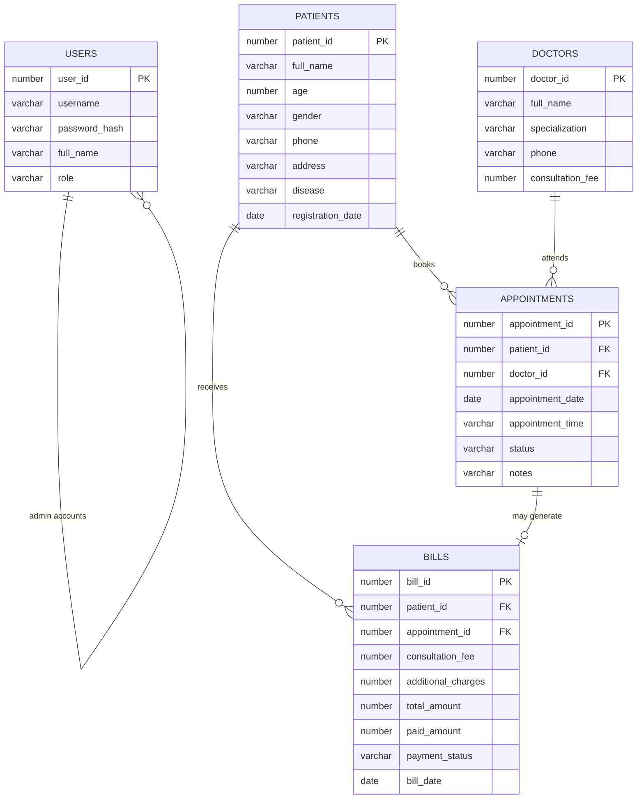

# Hospital Management System — University Project Documentation

**Course:** Database Systems (DBS)  
**Application:** LifeLine General Hospital Management System  
**Stack:** HTML, CSS, JavaScript, Python Flask, Oracle Database XE 11g  

---

## 1. Introduction and objectives

Hospitals generate large amounts of related data every day: patients, doctors, appointment slots, and bills. If this information is kept in paper registers or disconnected spreadsheets, staff lose time, make duplicate bookings, and cannot trust revenue totals.

This project is a **web-based Hospital Management System**. Clerks and administrators log in through a browser. The Flask server validates input and stores every record in **Oracle Database**. The interface is only a front end; Oracle is the system of record.

**Objectives**

1. Design a normalized relational schema with keys and constraints.
2. Implement full Create, Read, Update, and Delete operations for core entities.
3. Enforce business rules (existing patient/doctor, no double-booking, bill totals, payment status).
4. Protect the application with hashed passwords and login sessions.
5. Show live dashboard statistics queried from Oracle, not typed into HTML.

---

## 2. Problem statement

A typical small hospital needs one place to:

- register patients and assign unique IDs  
- keep a doctor directory with specialization and fee  
- book, complete, or cancel appointments  
- produce bills and track paid / unpaid / partial payments  
- see how many patients, doctors, appointments, and how much money was collected  

Without a database application, two staff members can book the same doctor at the same time, bills can be calculated by hand incorrectly, and old files are hard to search. The problem this project solves is: **how to manage hospital operational data accurately, with relationships that Oracle itself enforces.**

---

## 3. Scope of the system

**In scope**

- Administrator login  
- Patient management  
- Doctor management, including a doctor’s appointment list  
- Appointment booking and status tracking  
- Billing, payment status, printable receipt  
- Dashboard counts and recent activity  
- Oracle schema (`hospital.sql`) and beginner setup guide  

**Out of scope** (on purpose, for a semester DBS project)

- Patient self-registration / mobile app  
- Pharmacy inventory and lab machines  
- Insurance claims  
- Multi-branch hospitals and role-based modules beyond Admin  
- Email/SMS reminders  

---

## 4. Functional requirements

| ID | Requirement |
| --- | --- |
| FR-1 | Admin can log in and log out. Unauthenticated users cannot open internal pages. |
| FR-2 | System generates unique patient, doctor, appointment, and bill IDs. |
| FR-3 | Admin can add, search, view, update, and delete patients. |
| FR-4 | Patient records store name, age, gender, phone, address, disease, and registration date. |
| FR-5 | Admin can add, search, view, update, and delete doctors. |
| FR-6 | Doctor records store ID, name, specialization, phone, and consultation fee. |
| FR-7 | Admin can view all appointments for a selected doctor. |
| FR-8 | Admin can book an appointment only for an existing patient and doctor. |
| FR-9 | Appointment stores date, time, and status (Scheduled, Completed, Cancelled). |
| FR-10 | The same doctor cannot have two non-cancelled appointments at the same date and time. |
| FR-11 | Admin can generate a bill with consultation fee, extra charges, total, paid amount, and payment status. |
| FR-12 | Payment status is Paid, Unpaid, or Partial. |
| FR-13 | Admin can search bills and print a receipt. |
| FR-14 | Dashboard total revenue is the sum of amounts actually paid. |
| FR-15 | The system shows success and error messages, including database connection failures. |

## 5. Non-functional requirements

| ID | Requirement |
| --- | --- |
| NFR-1 | UI is readable on laptop, tablet, and phone. |
| NFR-2 | Passwords are hashed (PBKDF2 via Werkzeug), not stored in plain text. |
| NFR-3 | Database credentials live in `.env`, never in JavaScript. |
| NFR-4 | SQL uses bind variables to reduce injection risk. |
| NFR-5 | The app uses a dedicated Oracle user (`hms_app`), not SYSTEM, for daily work. |
| NFR-6 | Data remains after the Flask process is stopped and started again. |
| NFR-7 | Compatible with Oracle Database XE 11g (sequences + triggers, no 12c `IDENTITY`). |

---

## 6. ER diagram



**Relationships**

- One patient can have many appointments and many bills.  
- One doctor can have many appointments.  
- One appointment belongs to one patient and one doctor.  
- A bill belongs to one patient and may optionally point to one appointment.

---

## 7. Relational schema

```text
PATIENTS(
  patient_id PK,
  full_name,
  age,
  gender,
  phone,
  address,
  disease,
  registration_date
)

DOCTORS(
  doctor_id PK,
  full_name,
  specialization,
  phone,
  consultation_fee
)

APPOINTMENTS(
  appointment_id PK,
  patient_id FK → PATIENTS.patient_id,
  doctor_id FK → DOCTORS.doctor_id,
  appointment_date,
  appointment_time,
  status,
  notes,
  created_on
)

BILLS(
  bill_id PK,
  patient_id FK → PATIENTS.patient_id,
  appointment_id FK → APPOINTMENTS.appointment_id,
  consultation_fee,
  additional_charges,
  total_amount,
  paid_amount,
  payment_status,
  bill_date
)

USERS(
  user_id PK,
  username UNIQUE,
  password_hash,
  full_name,
  role
)
```

IDs are produced by sequences (`seq_patient_id`, `seq_doctor_id`, `seq_appointment_id`, `seq_bill_id`, `seq_user_id`) and BEFORE INSERT triggers. That pattern is valid on Oracle XE 11g.

A **function-based unique index** on appointments blocks two active bookings for the same doctor, date, and time, while still allowing the slot to be reused after Cancelled.

---

## 8. Table descriptions

### PATIENTS

| Column | Type | Notes |
| --- | --- | --- |
| PATIENT_ID | NUMBER PK | From `seq_patient_id` (starts at 1001) |
| FULL_NAME | VARCHAR2(100) | Required |
| AGE | NUMBER(3) | 0–150 |
| GENDER | VARCHAR2(10) | Male / Female / Other |
| PHONE | VARCHAR2(20) | Required |
| ADDRESS | VARCHAR2(255) | Optional |
| DISEASE | VARCHAR2(150) | Optional |
| REGISTRATION_DATE | DATE | Default SYSDATE |

### DOCTORS

| Column | Type | Notes |
| --- | --- | --- |
| DOCTOR_ID | NUMBER PK | From `seq_doctor_id` (starts at 201) |
| FULL_NAME | VARCHAR2(100) | Required |
| SPECIALIZATION | VARCHAR2(100) | Required |
| PHONE | VARCHAR2(20) | Required |
| CONSULTATION_FEE | NUMBER(10,2) | >= 0 |

### APPOINTMENTS

| Column | Type | Notes |
| --- | --- | --- |
| APPOINTMENT_ID | NUMBER PK | From `seq_appointment_id` |
| PATIENT_ID | NUMBER FK | Must exist in PATIENTS |
| DOCTOR_ID | NUMBER FK | Must exist in DOCTORS |
| APPOINTMENT_DATE | DATE | Required |
| APPOINTMENT_TIME | VARCHAR2(5) | HH:MM, 24-hour |
| STATUS | VARCHAR2(20) | Scheduled / Completed / Cancelled |
| NOTES | VARCHAR2(255) | Optional |

### BILLS

| Column | Type | Notes |
| --- | --- | --- |
| BILL_ID | NUMBER PK | From `seq_bill_id` |
| PATIENT_ID | NUMBER FK | Required |
| APPOINTMENT_ID | NUMBER FK | Optional |
| CONSULTATION_FEE | NUMBER(10,2) | |
| ADDITIONAL_CHARGES | NUMBER(10,2) | |
| TOTAL_AMOUNT | NUMBER(10,2) | Fee + extra (trigger maintains it) |
| PAID_AMOUNT | NUMBER(10,2) | Cannot exceed total |
| PAYMENT_STATUS | VARCHAR2(20) | Paid / Unpaid / Partial |

### USERS

| Column | Type | Notes |
| --- | --- | --- |
| USER_ID | NUMBER PK | From `seq_user_id` |
| USERNAME | VARCHAR2(50) | Unique |
| PASSWORD_HASH | VARCHAR2(255) | Werkzeug hash |
| FULL_NAME | VARCHAR2(100) | |
| ROLE | VARCHAR2(20) | Admin |

---

## 9. Sample SQL queries

Use these in SQL Developer (as `hms_app`) during the viva if asked to “show queries”.

**Dashboard counts**

```sql
SELECT COUNT(*) AS total_patients FROM patients;
SELECT COUNT(*) AS total_doctors FROM doctors;
SELECT COUNT(*) AS total_appointments FROM appointments;
SELECT NVL(SUM(paid_amount), 0) AS total_revenue
FROM bills
WHERE payment_status IN ('Paid', 'Partial');
```

**Search patient by name or ID**

```sql
SELECT patient_id, full_name, phone, disease
FROM patients
WHERE patient_id = 1001
   OR UPPER(full_name) LIKE '%AYESHA%';
```

**Appointments of one doctor**

```sql
SELECT a.appointment_id, p.full_name AS patient_name,
       a.appointment_date, a.appointment_time, a.status
FROM appointments a
JOIN patients p ON p.patient_id = a.patient_id
WHERE a.doctor_id = 201
ORDER BY a.appointment_date, a.appointment_time;
```

**Prevented double booking (application also checks this)**

```sql
SELECT COUNT(*) AS clashes
FROM appointments
WHERE doctor_id = 201
  AND TRUNC(appointment_date) = DATE '2026-10-12'
  AND appointment_time = '10:00'
  AND status <> 'Cancelled';
```

**Unpaid bills**

```sql
SELECT b.bill_id, p.full_name, b.total_amount, b.paid_amount, b.payment_status
FROM bills b
JOIN patients p ON p.patient_id = b.patient_id
WHERE b.payment_status <> 'Paid';
```

**Parameterized insert (how the Python code works)**

```sql
INSERT INTO patients (full_name, age, gender, phone, address, disease)
VALUES (:full_name, :age, :gender, :phone, :address, :disease);
```

The Flask code never builds SQL by gluing raw form text into the statement.

---

## 10. Testing checklist

| # | Test | Expected result |
| --- | --- | --- |
| 1 | Open `/` without login | Redirect to login |
| 2 | Wrong password | Error message, stay on login |
| 3 | Correct admin login | Dashboard opens |
| 4 | Add patient | New ID, row in `PATIENTS` |
| 5 | Search patient by ID and name | Matching rows only |
| 6 | Edit patient phone | Updated value after refresh |
| 7 | Delete patient with no links | Row removed after confirm |
| 8 | Delete patient who has appointments | Blocked with explanation |
| 9 | Add doctor | New ID and fee stored |
| 10 | Open doctor appointments | List for that doctor only |
| 11 | Book appointment | Row in `APPOINTMENTS` |
| 12 | Book same doctor/time again | Error; no second row |
| 13 | Cancel appointment, then reuse slot | Second booking allowed |
| 14 | Generate bill, pay part | Status Partial; dashboard revenue increases by paid amount |
| 15 | Print bill | Receipt shows Oracle values |
| 16 | Stop and restart Flask | All rows still present |
| 17 | Stop Oracle listener, try save | Friendly connection error |
| 18 | Narrow browser window | Sidebar / cards still usable |

---

## 11. Conclusion

The system is a working three-tier application: browser interface, Flask business logic, and Oracle persistence. Constraints, sequences, and foreign keys keep the data consistent even if someone tries invalid combinations. For a DBS course, the important lesson is that a hospital website is only useful if the **database design** (keys, relationships, and rules) is correct.

Possible later extensions: receptionist vs doctor roles, appointment SMS, ward/bed module, and reports by date range.

---

## 12. Viva questions with simple answers

**Q1. Why Oracle and not Excel?**  
Excel is a file, not a multi-user database. Oracle supports concurrent users, constraints, transactions, and recovery.

**Q2. What is a primary key?**  
A column (or set of columns) that uniquely identifies each row. Example: `PATIENT_ID`.

**Q3. What is a foreign key?**  
A column that points to a primary key in another table. `APPOINTMENTS.PATIENT_ID` must match a real patient.

**Q4. Why sequences instead of IDENTITY?**  
Oracle XE 11g does not provide 12c identity columns. Sequences plus triggers are the 11g-compatible way to auto-number IDs.

**Q5. What is a transaction?**  
A group of SQL statements that commit together or roll back together. The app commits after a successful change and rolls back on error.

**Q6. How do you stop SQL injection?**  
Use bind variables (`:patient_id`) instead of concatenating user text into SQL.

**Q7. How are passwords stored?**  
As a one-way hash. The database cannot show the original password; login checks the hash.

**Q8. Why not connect Flask as SYSTEM?**  
SYSTEM is a powerful DBA account. A dedicated user (`hms_app`) with only the needed privileges limits damage if the app password leaks.

**Q9. What is thick mode?**  
`python-oracledb` needs Oracle Instant Client to speak to 11g. Thin mode is for newer databases.

**Q10. How is total revenue calculated?**  
`SUM(paid_amount)` for bills that are Paid or Partial, so only money actually received is counted.

**Q11. What happens if two appointments clash?**  
The application counts existing non-cancelled rows for that doctor/date/time. Oracle also has a unique function-based index as a second line of defense.

**Q12. Can you delete a patient who has bills?**  
No. The app checks related rows. Foreign keys would also reject the delete.

**Q13. Difference between Cancelled and deleted appointment?**  
Cancelled keeps history and frees the time slot. Delete removes the row if no bill is linked.

**Q14. What is 1:M?**  
One doctor has many appointments. That is one-to-many.

**Q15. What is normalization here?**  
Patient name is not copied into bills as the only source of truth; bills store `patient_id` and join to `PATIENTS`.

**Q16. What is an ER diagram?**  
A picture of entities and relationships used before writing CREATE TABLE statements.

**Q17. Why session authentication?**  
After login, the server remembers the user in a signed cookie/session so every request does not resend the password.

**Q18. What is a CHECK constraint?**  
A rule inside the table, for example gender must be Male, Female, or Other.

**Q19. How would you find patients registered today?**  
`SELECT * FROM patients WHERE TRUNC(registration_date) = TRUNC(SYSDATE);`

**Q20. If the website shows 0 patients but SQL Developer shows rows, what is wrong?**  
Flask is probably connected as a different user/schema than the one that owns the tables.

---

## 13. How to demonstrate in the lab

1. Show `hospital.sql` (tables, FKs, sequences).  
2. Show a live insert in the browser.  
3. In SQL Developer, `SELECT` the new row.  
4. Show the dashboard query results changing.  
5. Show a rejected duplicate appointment.  
6. Mention bind variables and hashed passwords if asked about security.
